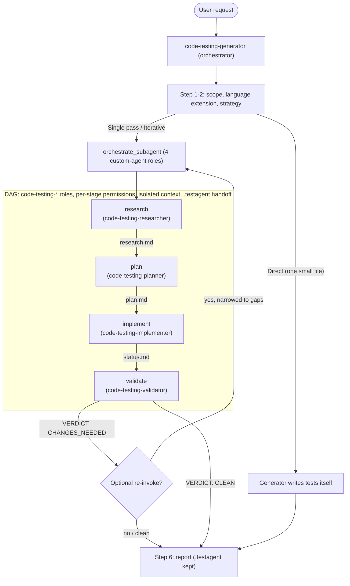

# dotnet-test-creator-v2

A port of `dotnet-test-creator` to the **Kiro v3 / KAS backend**. It generates comprehensive,
_verified_ unit tests for any language using a **Research → Plan → Implement → Validate** pipeline,
handing off through `.testagent/*.md` artifacts.

Despite the name, the pipeline is **polyglot** — language specifics live in the per-language
extension files under the original plugin's `skills/code-testing-extensions/extensions/` (.NET,
Python, TypeScript, Go, Java, Rust, Ruby, Swift, Kotlin, PowerShell, C++). This v2 directory ships
the orchestrator + the four stage agents + stage definitions; it reuses the v1 plugin's skill library.

## Why a v2 exists

v1 was built on the CLI **crew engine**: the `code-testing-generator` agent held the `subagent` tool
plus `toolsSettings.crew.availableAgents`/`trustedAgents`, and orchestration was a declarative DAG
(`crew-dag.json` / `crew-dag-loop.json`) with stages linked by `depends_on` and an optional
`loop_to` cycle fired via the built-in `summary` tool. **The crew engine does not exist on v3** —
KAS exposes orchestration through the **`orchestrate_subagent`** tool instead.

`orchestrate_subagent` is an **acyclic DAG executor**, and — contrary to an earlier draft of this
port — it is much closer to the crew engine than first assumed. The accurate mapping:

| v1 (crew engine) | v3 (`orchestrate_subagent`) |
| --- | --- |
| `subagent` tool + `toolsSettings.crew` | `orchestrate_subagent` tool; **no crew settings needed** — roles are discovered from the registry |
| Custom agents named as stage roles (`code-testing-researcher`, …) | **Same — custom agents ARE the roles.** `role` is a Zod enum generated over the registered agents, so any registered agent is a valid role |
| Per-stage specialization via separate agent JSON + prompt | **Same** — each stage runs as its named agent, with that agent's own system prompt and tools |
| Per-stage tool/path **sandboxing** (`write.allowedPaths`, shell allowlists) | **Enforced** — each role runs under its own `permissions` rules (deny-wins, combined restrictively with the parent) |
| Native iteration via `loop_to` + `summary(resultType="changes_needed")` + `max_iterations` | **No native loop** — the one real difference. `orchestrate_subagent` rejects cycles; iteration is an optional orchestrator re-invoke |
| `crew-dag.json` / `crew-dag-loop.json` loaded by the engine | `stages.json` is **reference-only**; the payload is passed inline to the tool |

What ports cleanly: the four-stage ordering (via `depends_on`), the named custom-agent roles, the
**enforced per-stage permissions**, the `.testagent/*.md` file handoff (shared cwd), the stage
methodologies, and **isolated context per stage**.

The **only** thing you give up is the native `loop_to` cycle — and that is fine. A single clean pass
is a complete outcome; iteration, when wanted, is an orchestrator re-invoke (below).

### Registration matters (the migration trap)

KAS only registers an agent — and therefore only offers it as a `role` — if its config carries a
`permissions` block. An agent that uses the v1/v2 `allowedTools` / `toolsSettings` fields **without**
a `permissions` block is **silently dropped** at load (KAS treats it as a CLI-only profile). So this
v2 directory ships **KAS-shaped** stage agents (`tools` + `permissions`, no `allowedTools`/
`toolsSettings`). If the model ever reports that a `code-testing-*` role "is not available", the
agent failed to register — check it has a `permissions` block and lives in `.kiro/agents/`.

> **Prerequisite.** `orchestrate_subagent` is only exposed when the host has enabled the
> `subagentOrchestration` setting. Without it, KAS exposes the single-shot `invoke_sub_agent` tool
> instead — the orchestrator then runs the same roles one at a time in `depends_on` order (the
> `.testagent/*.md` handoff is unchanged).

## Quick start

This plugin targets the **KAS (v3) engine** — `orchestrate_subagent` does **not** exist on the
default v2 engine, so you must launch with `--v3` (or `--agent-engine v3`):

```bash
kiro-cli chat --v3 --agent code-testing-generator
# then: "Generate unit tests for <path>"
```

> **Wrong engine = no orchestration.** If you launch without `--v3`, the session runs on the v2
> Rust engine, where `orchestrate_subagent` is absent (v2's equivalent is `agent_crew`) and the
> KAS tool ids (`read_file`, `fs_write`, …) don't resolve. The orchestrator will then just do the
> work inline instead of running the crew. **For the default v2 engine, use the sibling
> `dotnet-test-creator` plugin instead** — it's built on `agent_crew` (+ a native `loop_to`).

After a run, `.testagent/` (`research.md`, `plan.md`, `status.md`) is intentionally left in place as
the audit trail — add it to `.gitignore`.

## Agent flow



## The stages

Each stage's `role` is a **registered custom agent** (`agents/code-testing-*.json`), running its own
system prompt (`prompts/code-testing-*.md`) under its own enforced tools and `permissions`. The
stage `prompt_template` carries only the task, not the methodology.

| stage | role | enforced scope (`permissions` + tool grant) |
| --- | --- | --- |
| **research** | `code-testing-researcher` | no shell; `fs_write` denied except `.testagent/**` → writes only `research.md` |
| **plan** | `code-testing-planner` | no shell; `fs_write` denied except `.testagent/**` → writes only `plan.md` |
| **implement** | `code-testing-implementer` | shell + write; `fs_write` denied under any `.git/` → writes tests, builds/tests/fixes inline, appends `status.md` |
| **validate** | `code-testing-validator` | shell + read; `fs_write` denied except `.testagent/**` → **structurally cannot edit tests or source**, only reports a verdict into `status.md` |

The validator's write-lock is the clearest payoff of enforced per-stage permissions: it runs the full
build/test and audit but is physically prevented from "fixing" anything — it can only report
`VERDICT: CLEAN` or `VERDICT: CHANGES_NEEDED` + a categorized FAILING/MISSING/WEAK/SMELL list.

## Iteration (replaces `loop_to`) — optional

`orchestrate_subagent` has no native loop, and that is fine. If you want to chase a coverage/quality
target across passes, the orchestrator reads the validate stage's `VERDICT` and, on `CHANGES_NEEDED`,
re-invokes `orchestrate_subagent` with `{task}` narrowed to the named gaps (suffixed artifacts
`research-2.md`, `plan-2.md` to preserve the audit trail). Bound it yourself (the prompt caps it at
3 re-invocations) and report remaining gaps as follow-ups rather than looping forever. A single clean
pass needs no iteration at all.

> **Want the loop closer to v1's feel?** Two KAS-native options, both outside this DAG: (1) add a
> bundled verification agent as a stage role — `functional_task_alignment` (claim/diff validation,
> enable with the `fta` setting) or `semantic_reviewer` (enabled by default) — for a one-shot
> independent check; (2) gate iteration in a `PreToolUse`/hook with its own cap. Neither restores a
> cyclic crew, but both add a verification beat without an orchestrator round-trip.

## Files in this directory

```
dotnet-test-creator-v2/
├── README.md
├── stages.json                         # reference orchestrate_subagent payload (not engine-loaded)
└── agents/
    ├── code-testing-generator.json     # orchestrator; holds orchestrate_subagent
    ├── code-testing-researcher.json    # research-stage role (KAS-shaped)
    ├── code-testing-planner.json       # plan-stage role
    ├── code-testing-implementer.json   # implement-stage role
    ├── code-testing-validator.json     # validate-stage role
    └── prompts/
        ├── code-testing-generator.md
        ├── code-testing-researcher.md
        ├── code-testing-planner.md
        ├── code-testing-implementer.md
        └── code-testing-validator.md
```

Unlike the first v2 draft, the four stage agents **are** carried over from v1 — re-shaped for KAS
(`tools` + `permissions`, no `allowedTools`/`toolsSettings`) so KAS registers them and
`orchestrate_subagent` offers them as roles. The skill library is reused from the v1 plugin unchanged.

## Permissions: enforced per stage

On v3 each stage runs as its own registered agent under its own `permissions.rules`, evaluated
**deny-wins** and combined restrictively with the parent session — a stage can only be scoped *down*
from the orchestrator, never escalate. The v1 per-stage sandboxing therefore ports as real
enforcement, not just prose:

- **researcher / planner** — no `execute_bash` tool (cannot run shell at all) and `fs_write` denied
  outside `.testagent/**`.
- **validator** — has `execute_bash` (it must build/test) but `fs_write` is denied outside
  `.testagent/**`, so it cannot modify the tests it is judging.
- **implementer / generator** — broad write for real test work, with `fs_write` denied under `.git/`.

The one area that is coarser than v1: fine-grained **shell command** allow-listing. KAS *can* scope
shell via the `shell` capability (e.g. `{ "capability": "shell", "match": ["**"], "exclude": ["dotnet *", "npm *"], "effect": "deny" }`),
but its matcher is minimatch, whose `*` does not cross `/` — so a naive allow-list would block
path-bearing build commands (`dotnet test ./tests/Foo.csproj`). Rather than risk breaking the
toolchain, these configs grant `execute_bash` to the stages that need it and keep the command
restriction stated in the stage prompts. Add a `shell` rule if your environment needs hard
command-level enforcement and your commands avoid path arguments.
