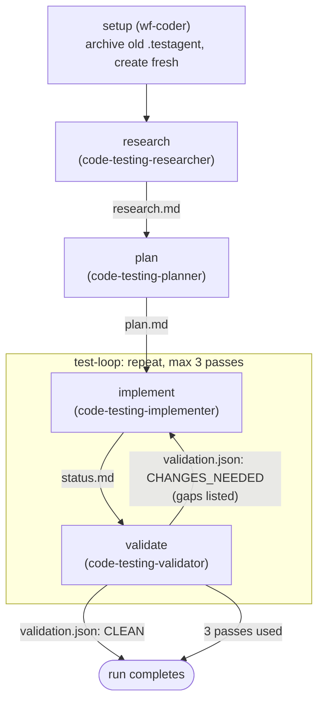

# dotnet-test-creator-v3

A port of `dotnet-test-creator-v2` to **Kiro workflows** (kiro-cli 2.26.0+, KAS engine). It generates
comprehensive, _verified_ unit tests for any language using a **Research → Plan → Implement ⇄ Validate**
pipeline, handing off through `.testagent/*.md` files.

Despite the name, the pipeline is **polyglot** — language specifics live in the per-language extension
files under the v1 plugin's `skills/code-testing-extensions/extensions/` (.NET, Python, TypeScript, Go,
Java, Rust, Ruby, Swift, Kotlin, PowerShell, C++). Like v2, this directory ships the agents and
orchestration; it reuses the v1 plugin's skill library.

## Why a v3 exists

v2 orchestrated with the `orchestrate_subagent` tool: the `code-testing-generator` agent built a
four-stage DAG inline on every request, and iteration was a hand-written loop in its prompt ("read the
verdict, re-invoke with the gaps, at most 3 times").

v3 moves the pipeline into a **workflow recipe**, `dotnet-test-generation.workflow.json`. What that buys:

| v2 (`orchestrate_subagent`) | v3 (workflow recipe) |
| --- | --- |
| DAG payload re-emitted by the model on every run (`stages.json` was reference-only) | The recipe **is** the pipeline: a checked-in file the engine validates before anything runs |
| Iteration = orchestrator re-invokes the DAG, model-enforced cap, `research-2.md`/`plan-2.md` juggling | A native **`repeat`** loop over implement → validate, stopped when the verdict file says `CLEAN` (max 3 passes) |
| Validator's verdict = a `VERDICT:` line of text the orchestrator had to parse | Validator writes `.testagent/validation.json`; the engine checks it directly |
| Stale `.testagent/` from an earlier run could mislead a new one | A `setup` step archives it to `.testagent-prev-<timestamp>` first |
| Runs inside the orchestrator's turn | Runs in the background with a monitor (`/workflow`), pause/resume/retry, and steering |
| Needs the host's `subagentOrchestration` setting | Needs the user's **Workflows** feature setting |

Unchanged: the four named stage agents with their own prompts and enforced `permissions`, the
`.testagent/*.md` file handoff, the stage methodologies, and isolated context per stage (every
workflow step is its own session).

## Install

Copy into the target workspace (or `~/.kiro/` for the agents and the recipe, to use it everywhere):

```sh
PLUGIN=path/to/plugins/dotnet-test-creator-v3
SKILLS=path/to/plugins/dotnet-test-creator/skills       # v1 skill library, reused

mkdir -p .kiro/agents .kiro/workflows .kiro/skills
cp -r "$PLUGIN"/agents/. .kiro/agents/                  # 5 agent JSONs + prompts/
cp "$PLUGIN"/workflows/dotnet-test-generation.workflow.json .kiro/workflows/
for s in code-testing-agent code-testing-extensions test-analysis-extensions \
         test-gap-analysis assertion-quality test-anti-patterns; do
  cp -r "$SKILLS/$s" .kiro/skills/
done
echo '.testagent*/' >> .gitignore
```

The `.workflow.json` suffix is required — the loader rejects a plain `.json` file in `.kiro/workflows/`.

## Enable workflows

Workflows are off by default, and only exist on the v3 (KAS) engine:

1. `kiro-cli chat --v3`
2. `/settings` → **Features** → enable **Workflows** (stored as `chat.enableWorkflows`)
3. Exit and restart Kiro CLI — workflow commands are fixed when the process starts.

## Run

Any of these:

- **Through the generator agent** — `kiro-cli chat --v3 --agent code-testing-generator`, then
  "Generate unit tests for `<path>`". It writes tests itself for one small file, and otherwise launches
  the workflow with `run_workflow` and reports the verdict when the run finishes.
- **Directly** — `/workflow run`, pick `dotnet-test-generation`, and give the `task` input (your
  test-generation request).
- **Ask the default agent** — with workflows enabled, the main agent can launch saved recipes with
  `run_workflow` itself.

Follow a run with `/workflow` (full-screen monitor: `p` pause, `r` resume/retry, `s` steer or reply to a
step, Ctrl+X twice to stop) or `/workflow status <id>`. `/workflow retry <id>` re-runs only failed steps.

## Flow



- **First pass** — `.testagent/validation.json` does not exist yet, so the implementer works through
  every phase of `plan.md`.
- **Later passes** — the implementer addresses only the gaps the validator listed
  (`FAILING`/`MISSING`/`WEAK`/`SMELL`). It may fix tests it created earlier in the run; pre-existing
  test files stay append-only.
- **Out of passes** — the run still completes (`onMaxIterations: "continue"`); the last
  `validation.md` stands as the list of known gaps. Change it to `"pause"` if you'd rather decide by
  hand, or `"abort"` to fail the run.

## The steps

| step | agent | enforced scope (`permissions` + tool grant) | writes |
| --- | --- | --- | --- |
| **setup** | bundled `wf-coder` (low effort) | — | renames old `.testagent/`, creates a fresh one |
| **research** | `code-testing-researcher` | no shell; `fs_write` denied except `.testagent/**` | `research.md` |
| **plan** | `code-testing-planner` | no shell; `fs_write` denied except `.testagent/**` | `plan.md` |
| **implement** | `code-testing-implementer` | shell + write; `fs_write` denied under `.git/` and on `validation.{json,md}` | test files, `status.md` |
| **validate** | `code-testing-validator` | shell + read; `fs_write` denied except `.testagent/**` | `validation.md`, `validation.json`, `status.md` |

The implementer's deny rule on the verdict files keeps it from writing the `CLEAN` that ends the loop;
the validator's write-lock keeps it from "fixing" what it reports. (The implementer still has shell, so
the first guarantee against a shell redirect is prompt-level only.)

`validation.json` shape:

```json
{ "verdict": "CHANGES_NEEDED",
  "gaps": [ { "category": "MISSING", "item": "src/Foo/Baz.cs — no tests" } ] }
```

## Verification status

Checked against kiro-cli 2.26.0 (KAS 0.66.15) without spending credits — `_kiro/workflow/new` runs the
engine's full load-time validation but executes nothing:

- All five `code-testing-*` agents register under KAS.
- The recipe validates with every step agent resolved, including the ones inside the loop. A bogus
  agent name in the loop body is rejected, so the check does reach it.

**Not yet verified in a live run:**

- That each agent's `permissions` deny rules hold when it runs as a workflow step. They were
  established for `orchestrate_subagent` stages; workflow steps are separate peer sessions.
- That the generator can call `run_workflow` when the tool is named in its `tools` list.
- An end-to-end run on a real project, including a loop re-entry.

## Notes

- **Permission prompts.** The implementer's and validator's `dotnet build` / `dotnet test` calls ask
  for approval in your session. Add `effect: "allow"` shell rules to those agents if you want unattended
  runs — but note the `shell` matcher's `*` does not cross `/`, so path-bearing commands
  (`dotnet test ./tests/Foo.csproj`) need care.
- **The original request is visible to every step.** By default each step's first prompt quotes your
  chat messages from the session that launched the run, so steps can check their work against your own
  words. Set `"injectOriginalUserRequest": false` in the recipe if that session holds unrelated or
  private conversation.
- **When the run finishes, the launching session takes a turn** to pick up the result — that is how the
  generator gets to report it.
- **Audit trail.** `.testagent/` (`research.md`, `plan.md`, `status.md` with every pass's verdict,
  `validation.md`, `validation.json`) and any archived `.testagent-prev-*` directories are left in place.

## Files in this directory

```
dotnet-test-creator-v3/
├── README.md
├── workflows/
│   └── dotnet-test-generation.workflow.json   # the pipeline (copy to .kiro/workflows/)
└── agents/
    ├── code-testing-generator.json            # entry point; holds run_workflow
    ├── code-testing-researcher.json
    ├── code-testing-planner.json
    ├── code-testing-implementer.json
    ├── code-testing-validator.json
    └── prompts/
        ├── code-testing-generator.md
        ├── code-testing-researcher.md          # unchanged from v2
        ├── code-testing-planner.md             # unchanged from v2
        ├── code-testing-implementer.md
        └── code-testing-validator.md
```
