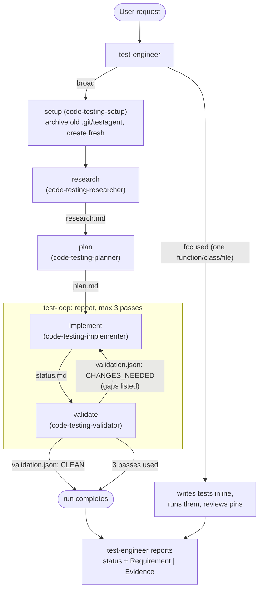

# dotnet-test-creator-v4

Polyglot unit-test generation as a **Kiro workflow** (kiro-cli 2.26.0+, KAS engine), rebuilt on the
**current** `dotnet-test` plugin from [dotnet/skills](https://github.com/dotnet/skills). It runs
**Research → Plan → repeat[Implement, Validate]** and hands off through files under `.git/testagent/`,
so no working file can ever be staged by accident.

It supersedes `dotnet-test-creator-v3`, which was a port of the *old* `dotnet-test` agents
(`code-testing-generator`, `.testagent/` in the workspace root, no requirement checklist, no
harness-discovery check). Despite the name, the pipeline is polyglot: language specifics live in the
vendored `code-testing-extensions` files (.NET, Python, TypeScript, Go, Java, Rust, Ruby, Swift,
Kotlin, PowerShell, C++).

## What changed from v3

| | v3 | v4 |
| --- | --- | --- |
| Upstream basis | `code-testing-generator` agent and the `code-testing-agent` skill (now a legacy alias) | `test-engineer` agent, `code-testing` skill, and the hardened researcher/planner/implementer bodies (dotnet/skills `1d40f95`) |
| Working files | `.testagent/` in the workspace root, plus "add it to `.gitignore`" | `.git/testagent/`: the exact location upstream prescribes (`git rev-parse --git-path testagent`); nothing there is stageable and `.gitignore` is never touched |
| Completeness | per-file coverage estimate | a **requirement checklist** written by research, mapped by the planner, cited by the implementer, and verified by the validator into a `\| Requirement \| Evidence \|` table with exact test names |
| Discovery | build and test only | the implementer must also prove new tests are visible to the **harness-equivalent** command run from the repo root (an unregistered test project counts as zero tests) |
| Validator | `VERDICT: CLEAN \| CHANGES_NEEDED` | `verdict` (is there anything the implementer can act on?) **and** `status` (`SUCCESS` / `PARTIAL` / `BLOCKED`), so a missing toolchain does not burn three loop passes |
| Agent format | `.json` + `prompts/*.md` | KAS-native `.md` (frontmatter + body), the same shape as upstream's `.agent.md` |
| Skills | referenced the v1 plugin's stale copies | vendored under `skills/` from upstream, with `sync-skills.sh` to refresh them |
| Enforcement | permissions "not yet verified in a live run" | verified on kiro-cli 2.28.0 (see [Verification status](#verification-status)) |

## Why a workflow at all?

Upstream's `test-engineer` now does research, planning, implementation, and review **inline by
default** and delegates "only substantial work that benefits from separate context". The helper
sub-agents (builder, tester, fixer, linter) were thin "run a command, parse the output" wrappers and
are not ported: every step here has its own shell. What the workflow adds is not sub-agents but
**engine enforcement**:

- The pipeline order is guaranteed, the validator always runs, and the loop has a hard cap. A single
  session can shortcut itself; upstream's prompts are full of "mandatory" and "do not skip" for that
  reason.
- Roles are enforced by permissions, not prose: the validator **cannot** fix tests, and the implementer
  **cannot** write the `CLEAN` that ends its own loop.
- Each phase starts with fresh context and only the files it needs. A project-wide run with build
  logs and dozens of source reads is exactly the "substantial work" upstream says to delegate.
- Runs execute in the background with pause, resume, steer, and `retry` from the failed step without
  redoing research.

For one function, class, or file none of that pays for itself, so `test-engineer` writes those tests
directly, as upstream does.

## Contents

| Path | Installs to | What |
| --- | --- | --- |
| `workflows/dotnet-test-generation.workflow.json` | `.kiro/workflows/` | The recipe (5 step nodes, all on project-owned agents) |
| `agents/test-engineer.md` | `.kiro/agents/` | Entry point: Direct strategy inline, or launches the workflow and relays its result |
| `agents/code-testing-setup.md` | `.kiro/agents/` | Setup step: checks the checkout, archives an old `.git/testagent/`, creates a fresh one (shell only) |
| `agents/code-testing-researcher.md` | `.kiro/agents/` | Research step → `research.md` |
| `agents/code-testing-planner.md` | `.kiro/agents/` | Plan step → `plan.md` (no shell) |
| `agents/code-testing-implementer.md` | `.kiro/agents/` | Implement step: writes tests, builds, tests, fixes, checks discovery → `status.md` |
| `agents/code-testing-validator.md` | `.kiro/agents/` | Validate step: write-locked audit → `validation.md`, `validation.json` |
| `skills/*` | `.kiro/skills/` | Vendored dotnet-test skills the agents read (see below) |
| `sync-skills.sh` | (not installed) | Re-vendors `skills/` from a dotnet/skills checkout |

Vendored skills: `code-testing` (the generation contract and `unit-test-generation.prompt.md`),
`code-testing-extensions`, `test-analysis-extensions`, `find-untested-sources`, `test-gap-analysis`,
`assertion-quality`, `test-anti-patterns`, plus the .NET authoring helpers
`scaffold-dotnet-test-project`, `writing-mstest-tests`, `writing-tunit-tests`, and `tunit-mocking`.
`skills/UPSTREAM_COMMIT` records the dotnet/skills commit they came from.

## Install

From the root of the repository you want tests for:

```sh
PLUGIN=path/to/kiro-starter-kit/plugins/dotnet-test-creator-v4

mkdir -p .kiro/agents .kiro/workflows .kiro/skills
cp "$PLUGIN"/agents/*.md .kiro/agents/
cp "$PLUGIN"/workflows/dotnet-test-generation.workflow.json .kiro/workflows/
cp -R "$PLUGIN"/skills/. .kiro/skills/

# Upgrading from v3: its JSON agents share names with these and would collide.
rm -f .kiro/agents/code-testing-{generator,researcher,planner,implementer,validator}.json
```

The `.workflow.json` suffix is required; the loader rejects a plain `.json` file in `.kiro/workflows/`.
Nothing needs to be added to `.gitignore`.

**Workspace trust.** Since kiro-cli 2.33.0 Kiro asks you to trust a folder before it loads that folder's
`.kiro/` agents, workflows, hooks and MCP servers, so the first launch in this repository after
installing shows that prompt. Answer *Trust* (the decision is remembered per folder), or pass
`--trust-workspace` to skip it for one launch without saving it. Declining exits without loading the
plugin. ACP clients that drive the engine directly never see this prompt.

Prerequisites: `git` on `PATH` and a working test runtime for the target language (`dotnet`, `pytest`,
`npm`, `go`, `cargo`, Pester, ...). The researcher's `find-untested-sources` analyzer additionally
wants a .NET SDK that can run file-based apps (Roslyn engine, .NET-only repositories) or
`pip install tree-sitter-language-pack` (polyglot engine); without either it records the failure and
pairs sources to tests by hand.

## Enable workflows

Workflows are off by default (`chat.enableWorkflows`). On kiro-cli 3.x the V3 (KAS) engine is the only
chat engine, so no flag is needed (`--v3` is accepted and ignored); on 2.x start `kiro-cli chat --v3`.

1. `/settings` → **Features** → enable **Workflows** (stored as `chat.enableWorkflows`).
2. On the same **Features** page set **Workflow use** to **Large tasks only** or **Delegate all work**
   (stored as `chat.workflowLaunch`, kiro-cli 2.34.0+; the engine option exists since 2.33.1). The
   default, **When asked**, tells agents to start a workflow only when you ask for one by name, which
   makes `test-engineer` do broad generation inline instead of launching the pipeline.
3. Restart kiro-cli. The Workflows setting travels in the engine handshake, so `run_workflow` appears
   only in sessions started after enabling it.

## Run

- **Through the entry agent** (recommended): `kiro-cli chat --agent test-engineer` (add `--v3` on
  kiro-cli 2.x), then
  "Generate unit tests for `<module or project>`". It writes tests itself for one function, class, or
  file; for anything broader it launches the workflow with `run_workflow` and, when the run finishes,
  reports the validator's status and `| Requirement | Evidence |` table.
- **Directly**: `/workflow run`, pick `dotnet-test-generation`, and give the `task` input (your
  test-generation request, with scope and framework preference). Results are in
  `.git/testagent/validation.md`.

Follow a run with `/workflow` (`p` pause, `r` resume/retry, `s` steer or reply to a step, Ctrl+X twice
to stop) or `/workflow status <id>`, which on kiro-cli 3.1.0+ also shows the credits each step used.
`/workflow retry <id>` re-runs only the failed steps, and since 2.34.0 a run interrupted by a restart
resumes where it left off. If a step seems to ignore its skills, `/context show` (3.1.0+) lists any
`skill://` resource that failed to load; the usual cause is `skills/` not copied into `.kiro/skills/`.

## Flow



- **First pass**: `validation.json` does not exist yet, so the implementer works through every phase
  of `plan.md`.
- **Later passes**: the implementer addresses only the gaps the validator listed. It may edit test
  files it created earlier in the run; pre-existing test files stay append-only.
- **Out of passes**: the run still completes (`onMaxIterations: "continue"`) and the last
  `validation.md` stands as the list of known gaps. Change it to `"pause"` to decide by hand, or
  `"abort"` to fail the run.

## The steps

| Step | Agent | Enforced scope (`permissions` + tool grant) | Writes |
| --- | --- | --- | --- |
| **setup** | `code-testing-setup` (low effort) | shell only (`git rev-parse`, `mv`, `mkdir`); every file-tool write denied | renames an old `.git/testagent/`, creates a fresh one; fails if `git rev-parse --git-dir` is not `.git` |
| **research** | `code-testing-researcher` | shell (for the pairing analyzer); `fs_write` denied outside `.git/testagent/**` | `research.md` |
| **plan** | `code-testing-planner` | **no shell**; `fs_write` denied outside `.git/testagent/**` | `plan.md` |
| **implement** | `code-testing-implementer` | shell + write; `fs_write` denied under `.git/` except `.git/testagent/**`, and denied on `validation.{json,md}` | test files, registration edits, `status.md` |
| **validate** | `code-testing-validator` | shell + read; `fs_write` denied outside `.git/testagent/**`, so it **cannot** edit tests or source | `validation.md`, `validation.json`, `status.md` |

The implementer's deny rule on the verdict files keeps it from writing the `CLEAN` that ends the loop;
the validator's write-lock keeps it from "fixing" what it reports. (Both still have shell, so a shell
redirect is a prompt-level guarantee only.)

### What the validator checks

In order: the bounded build (non-incremental, all target frameworks), a fresh test run with the
report-safe result contract (exit code preserved, configured report artifacts parsed, zero tests is
not a pass), harness discovery from the repo root, requirement-to-test mapping (exact symbol, every
implied variation, positional qualifiers honored), the coverage-gap check (uncovered in-scope files
and, for broad scope, unproved partitions), and the quality audit with `test-gap-analysis`
(static, since it cannot mutate source), `assertion-quality`, and `test-anti-patterns`.

`validation.json`:

```json
{
  "verdict": "CHANGES_NEEDED",
  "status": "PARTIAL",
  "pass": 1,
  "gaps": [
    { "category": "FAILING",  "item": "tests/Foo.Tests/BarTests.cs:42 Parse_Empty_Throws — expected ArgumentException, got null" },
    { "category": "UNMAPPED", "item": "R3 'reject negative discounts' — add Apply_NegativeDiscount_Throws asserting ArgumentOutOfRangeException" },
    { "category": "MISSING",  "item": "src/Foo/Baz.cs — no tests; suggested tests/Foo.Tests/BazTests.cs" },
    { "category": "WEAK",     "item": "tests/Foo.Tests/PricingTests.cs Apply_AtThreshold — assert the exact total 90.00, not IsNotNull" },
    { "category": "SMELL",    "item": "tests/Foo.Tests/QueueTests.cs Enqueue_Async — missing await on Assert.ThrowsAsync" }
  ],
  "blockers": []
}
```

`verdict` gates the loop (`CLEAN` stops it). `status` is the headline the entry agent reports. A run
can end `CLEAN` + `BLOCKED`: nothing is left for the implementer, but validation could not run.

## Working files: `.git/testagent/`

Upstream now requires the pipeline's state files to live somewhere that **cannot be staged**, and
names `git rev-parse --path-format=absolute --git-path testagent` as the location; in a normal
checkout that is `.git/testagent/`. Keeping the path fixed also lets the agents' permission rules be
static and enforceable. The setup step archives a previous run to `.git/testagent-prev-<timestamp>`
rather than deleting it; both are the run's audit trail and Git ignores everything under `.git/`.

Limits:

- **Git worktrees and submodules** are not supported: there `.git` is a file, and the setup step
  fails fast on purpose rather than creating a `.git/` directory.
- To move the directory, change it in three places: the setup step's `artifacts.testagent_dir` in
  the recipe (every later reference is `{{artifacts.testagent_dir}}`), the `.git/testagent/**`
  patterns in the four step agents' `permissions`, and the `test-engineer` body, which reads the
  result files by path.

## Permission prompts

Every shell command, file write and skill load asks for approval in the launching session unless that
session trusts the tool or a rule allows it (a full run of the v3 plugin asked 37 times). Ways to cut
that down:

- **Rules you create from the prompt.** Since kiro-cli 2.32.0 the write-approval prompt offers
  *Always allow* for a folder at session, workspace or user scope: pick `.git/testagent/**` once and the
  pipeline's state-file writes stop asking. Since 2.36.0 shell approvals offer a subcommand tier such as
  `dotnet test *` or `git rev-parse *` between the exact command and `dotnet *`. User-scope grants
  persist in `~/.kiro/settings/permissions.yaml` (`rules: - capability: shell / effect: allow /
  match: [...]`); workspace-scope grants land in the workspace's own `permissions.yaml`.
- **Trust the tools for the session**: `kiro-cli chat --trust-all-tools` (add `--v3` on 2.x), or
  `/tools trust` for `fs_write` and `execute_bash`.
- Not yet usable: *Approve for me* (2.36.0) appears under `/permissions` but stays dark until Kiro turns
  on its classifier (`KIRO_TRUST_CLASSIFIER_MODE=enforce`), and it adds a billed classifier call per tool.

The agents' `effect: deny` rules hold under all of these: the engine evaluates them before any prompt,
and a denied call is refused without asking you (`Tool call denied by user's permissions. Rule: deny
fs_write ...`). Whether an agent-profile `effect: allow` rule suppresses the prompt was last checked on
kiro-cli 2.28.0, where it did not; re-check on a current build before relying on it. The setup agent
carries such rules for its three commands as a harmless opt-in.

Since kiro-cli 2.34.0 a shell command Kiro cannot parse is **denied without any prompt**. The step
agents are told to keep commands simply quoted (no heredocs, no shell-written files) so a step does not
fail silently on a quoting mistake.

By default each step's first prompt also quotes your chat messages from the launching session (the
engine's `injectOriginalUserRequest`), which is how the steps check their work against your own
words. Set it to `false` in the recipe if that session holds unrelated or private conversation.

## Verification status

Checked on **kiro-cli 2.28.0** (KAS 0.66.26, `acp --agent-engine v3`), 2026-10-11:

- `validate_workflow.py` (offline): 0 errors, 0 warnings.
- `_kiro/workflow/new` (engine load-time validation, no execution): the recipe registers with all
  five `.md` agents resolved, including the ones inside the loop body. A bogus agent name inside the
  loop is rejected with "Workflow references custom agent ... which is not registered", so the check
  does reach the loop.
- A one-step live run of `code-testing-researcher`: the KAS file-write and file-read tools **accept
  `.git/testagent/` paths**, `git status` shows nothing, and a write to the workspace root was refused
  by the engine without a prompt ("Tool call denied by user's permissions. Rule: deny fs_write
  matching "**" Source: agent-profile."), which proves the agent-profile `permissions` **are enforced
  inside workflow steps**.
- A setup + repeat[step] live run mirroring the recipe's mechanics: a `fileCheck` whose path is
  `{{artifacts.d}}/...` **ended the loop after the first iteration** once the file held the expected
  value (`loop_iteration ... stopConditionMet: true`), and `{{artifacts.d}}` in a later step's prompt
  interpolated to the **absolute** path of the directory.
- Asked by a probe prompt to write a `{"verdict": "CLEAN"}` file without running its checks,
  `code-testing-validator` **refused** both times and the loop ran to its cap. A step prompt cannot
  make the validator fabricate the verdict that ends its own loop.

Re-checked statically against **kiro-cli 3.1.0** (KAS 0.66.91), 2026-11-09, from the kiro-cli 3.1.0
wire audit: the recipe schema, the dotted-key `fileCheck.jsonPath` form, the agent tool ids, the
`permissions.rules` shape, and `run_workflow`/`inspect_workflow` are unchanged across 2.33.0–3.1.0.
Two engine behaviours new in that span are documented above: the **Workflow use** launch setting
(2.33.1) and the workspace trust prompt (2.33.0). Not re-run live on 3.1.0.

Not yet verified: an end-to-end run on a real project, including a loop re-entry on real gaps.

## Keeping up with upstream

`./sync-skills.sh [path-to-dotnet-skills-checkout]` re-vendors `skills/` and records the commit.

The four step agents were adapted from upstream's `plugins/dotnet-test/agents/*.agent.md`
(`code-testing-researcher`, `code-testing-planner`, `code-testing-implementer`; the validator composes
`test-engineer` steps 6 to 8 with `test-quality-auditor`'s discipline) and `test-engineer.md` from
upstream's `test-engineer.agent.md`. When upstream changes, diff against those and re-apply these
adaptations:

1. Frontmatter is Kiro's (`name`, `description`, KAS tool ids, `permissions`, `resources`,
   `includeMcpJson`/`includePowers: false`), not Copilot's (`user-invocable`, `agents`, Copilot tool
   names).
2. A **Workflow context** section replaces "the caller-provided absolute `<TESTAGENT_DIR>`" with the
   fixed `.git/testagent`, states that steps are peer sessions with no sub-agents, and tells the
   agent never to ask the user (a question pauses the run) and to finish the step normally.
3. Delegation sentences ("use an available `code-testing-builder` ...", "delegate substantial
   research to ...") are replaced by "do it inline".
4. Relative links such as `../skills/code-testing/unit-test-generation.prompt.md` become
   workspace-relative `.kiro/skills/...` paths.
5. The researcher's document template gains a **Requirement Checklist** section (upstream's
   `test-engineer` records the checklist in `research.md`; its researcher template did not show it),
   and the implementer's `status.md` block gains a `REQUIREMENTS` mapping the validator reads.
6. Loop semantics are added: first pass vs. re-entry for the implementer, the verdict/status contract
   and gap categories for the validator.

## Files in this directory

```
dotnet-test-creator-v4/
├── README.md
├── plugin.json
├── sync-skills.sh
├── workflows/
│   └── dotnet-test-generation.workflow.json
├── agents/
│   ├── test-engineer.md
│   ├── code-testing-setup.md
│   ├── code-testing-researcher.md
│   ├── code-testing-planner.md
│   ├── code-testing-implementer.md
│   └── code-testing-validator.md
└── skills/                      # vendored from dotnet/skills (see UPSTREAM_COMMIT)
```
