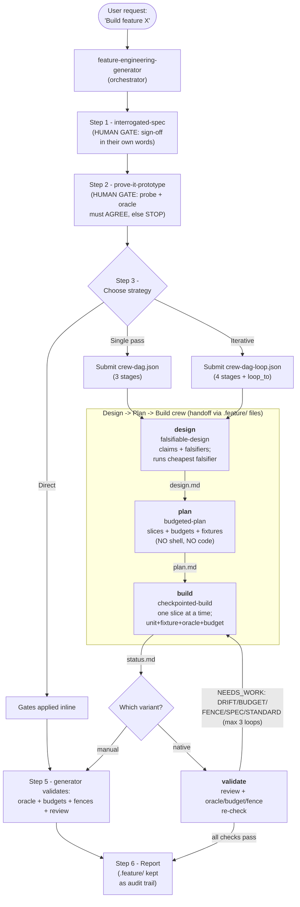

# feature-engineering

A Kiro plugin that builds features the way an engineer does, not the way a code
generator does — via an orchestrated **Spec → Probe → Design → Plan → Build (→ Validate)**
pipeline where the discipline is **enforced by the engine**, not merely suggested in a prompt.

It is the formal-workflow counterpart to spec-driven development: spec mode produces
*documents*; this produces a *self-enforcing pipeline* that refuses to advance on a vague
spec, refuses to design on a disproven understanding of the system, and (in the loop variant)
**stops and loops itself** when the built code drifts from the plan.

Despite living next to `dotnet-test-creator`, the pipeline is **polyglot** — stages use the
project's own build/test commands and an independent oracle appropriate to the stack
(`sqlite3`, a shell pipeline, `curl` against a running endpoint, etc.).

## Quick start

```bash
kiro-cli chat --agent feature-engineering-generator
# then: "Add an unread-count endpoint to the inbox service"
```

After a run, `.feature/` (`spec.md`, `probe.md`, `design.md`, `plan.md`, `status.md`) is
intentionally left in place as the audit trail — add it to `.gitignore`.

## The two kinds of gate

This is the central idea, and it's why the pipeline is split the way it is.

- **Human-adjudicated gates** need a person's verdict, so the **orchestrator** runs them in
  its own turns *before* the crew (a blocking crew can't do interactive interrogation):
  - **Spec sign-off** (`interrogated-spec`) — the requester must restate the feature in their
    own words; "looks good" is not sign-off.
  - **Probe/oracle agreement** (`prove-it-prototype`) — a probe and an *independent* oracle
    must agree before any design. Disagreement **stops** the run and surfaces to the user.
- **Engine gates** run autonomously inside the crew as DAG stages, including an
  engine-bounded **build⇄validate loop**.

## Agent flow

Everything starts with `feature-engineering-generator` — the **only** agent allowed to run a
crew. The four stage agents are leaves: they cannot spawn anything, and they hand off through
files in `.feature/` (the crew tool only substitutes `{task}`; it never pipes one stage's
output into the next — ordering comes from `depends_on`, data comes from the files; the sole
exception is the `loop_to` edge, which injects the validator's feedback into `build`).



## The agents (and what each is structurally allowed to do)

The permission scoping *is* the methodology. These are not honor-system instructions; the
engine enforces them.

| Agent | Writes production code? | Runs shell? | Can write `.feature/` contract files? |
|-------|------------------------|-------------|---------------------------------------|
| `feature-engineering-generator` (orchestrator) | yes (Direct only) | yes (probe/oracle/build) | yes — authors `spec.md`, `probe.md` |
| `feature-engineering-designer` | **no** (write scoped to `.feature/**`) | yes (runs the cheapest falsifier) | writes `design.md` only |
| `feature-engineering-planner` | **no — has no `write`-to-code, no `shell`, no `code` tool at all** | **no** | writes `plan.md` only |
| `feature-engineering-builder` | **yes — the only stage that does** | yes (build/test/oracle) | **denied** `spec/design/probe/plan.md`; appends `status.md` only |
| `feature-engineering-validator` | **no** (write scoped to `.feature/**`) | yes (oracle/budget/fences/review) | appends `status.md`; drives the loop |

Two enforcement highlights worth calling out:

- **The planner is structurally incapable of building.** Its tool list is `read`/`write`/`grep`/`glob`
  with `write` scoped to `.feature/**`. No `shell`, no `code`. It cannot run a command or write
  a line of production code even if the model "wanted" to. Planning is the only thing it *can* do.
- **The builder cannot tamper with the contract or the oracle.** It writes production code, but
  its `deniedPaths` include `spec.md`, `design.md`, `probe.md`, and `plan.md` — so it cannot make
  a slice "pass" by editing the spec or the oracle. It can only fix the code, or surface a
  conflict in `status.md`.

### `feature-engineering-generator` — orchestrator

Runs the two human gates (Steps 1–2), picks a strategy (Direct / Single pass / Iterative),
submits the crew, runs final validation for the manual variants, and reports. The only agent
with the `subagent` (crew) tool.

### `feature-engineering-designer` — stage 1 (`falsifiable-design`)

Enumerates input shapes, writes the design as numbered claims each paired with an independent,
non-vacuous, per-claim-distinct falsifier, **runs the cheapest falsifier** (must pass), and
lists negative space. Writes `.feature/design.md`.

### `feature-engineering-planner` — stage 2 (`budgeted-plan`)

Decomposes the design into ≤30-minute slices, each with a complexity/scale budget, a
bug-targeting stress fixture (expected output written first), an oracle, and exact file paths.
Writes `.feature/plan.md`. Has no way to run or build — by design.

### `feature-engineering-builder` — stage 3 (`checkpointed-build` + `tdd-scoped`)

Implements one slice at a time; after each, runs unit tests + the stress fixture + the oracle +
the budget check, and only advances when all five are green. On native-loop re-entry, addresses
only the validator's categorized feedback. Appends `.feature/status.md`.

### `feature-engineering-validator` — stage 4 (native-loop variant only)

Re-runs the oracle against the built code, re-checks budgets, runs the regression fences, and
runs the two-axis `review` (Standards + Spec). Fires `loop_to → build` via the `summary` tool
with `NEEDS_WORK` + a categorized `DRIFT/BUDGET/FENCE/SPEC/STANDARD` list, or returns terminal.

## The `.feature/` artifacts

The stages communicate only through these files; together they are the run's audit trail.

| File | Written by | Read by | Contents |
|------|-----------|---------|----------|
| `spec.md` | orchestrator | all | pinned behavior, measurable criteria, edge decisions, out-of-scope, verbatim sign-off |
| `probe.md` | orchestrator | designer, builder, validator | the probe, the independent oracle, the agreeing slice, "what I learned" |
| `design.md` | designer | planner, validator | claims + Falsification table (with Regression fence column) + negative space |
| `plan.md` | planner | builder, validator | slices with claim/oracle/fixture/budget/files + Plan Self-Review |
| `status.md` | builder & validator | (audit) | per-slice GREEN/BLOCKED blocks; validator's loop findings |

## Two iteration variants

| Variant | Payload | How iteration works | Loop bound |
|---------|---------|---------------------|------------|
| **Manual** | [`crew-dag.json`](crew-dag.json) (3 stages) | The generator validates in its own turns (Step 5) and re-submits a narrowed crew pass if needed | Orchestrator judgment |
| **Native** | [`crew-dag-loop.json`](crew-dag-loop.json) (4 stages) | The `validate` stage fires `loop_to → build` with `NEEDS_WORK` + categorized feedback | Engine-enforced `max_iterations` (3) |

Prefer the **native** variant for an engine-bounded build⇄validate loop. Cycles are never
expressed in `depends_on` edges — iteration exists only via `loop_to`.

## Upstream: the binding architecture

This pipeline builds one feature per run, but features only cohere into one system if they
share a technical spine. That spine is produced upstream and is **binding** here:

- `architecture-grill` → `ARCHITECTURE.md` + ADRs — module boundaries, seams, shared contracts,
  data ownership, dependency rules, cross-cutting conventions.
- `grill-with-docs` → `CONTEXT.md` (ubiquitous language) + ADRs.

All stage agents load `CONTEXT.md`, `CONTEXT-MAP.md`, `ARCHITECTURE.md`, and `docs/adr/**/*.md`
as resources. The **designer** may not contradict them (reuse boundaries/seams/contracts/
conventions rather than inventing), and the **validator's Standards axis** fails any slice that
violates a dependency rule, reaches across a module boundary, reinvents a shared contract, or
ignores an agreed convention — looping it back to build. If a feature genuinely can't fit the
architecture, the pipeline surfaces it rather than diverging (re-run `architecture-grill` / add
an ADR). This is the mechanism that keeps N independently-built vertical slices from drifting
into N divergent designs.

## Dependencies

The stage prompts are self-contained enough to carry the gates, but for full depth they
reference the gilfoyle/superpowers discipline skills via `skill://` resources. Install these
into `.kiro/skills/` (workspace) or `~/.kiro/skills/` (global):

`interrogated-spec`, `prove-it-prototype`, `falsifiable-design`, `budgeted-plan`,
`checkpointed-build`, `tdd-scoped`, `review` — plus `architecture-grill` and `grill-with-docs`
upstream, which produce the binding `ARCHITECTURE.md` / `CONTEXT.md` / ADRs.

## Permissions summary

- The **orchestrator** and **builder** auto-approve a polyglot build/test allowlist plus the
  probe/oracle tools (`sqlite3`, `jq`, `curl`, `python`) and writes under the workspace
  (`.git/**` denied; the builder additionally denies the `.feature/` contract files).
- The **designer** and **validator** may run build/test/oracle commands but write only to
  `.feature/**`.
- The **planner** has no `shell` and no `code` tool and writes only to `.feature/**`.
- `toolsSettings.crew` holds `availableAgents`/`trustedAgents`; the `subagent` (crew) tool is
  granted only to the orchestrator — the stage agents cannot spawn anything.
